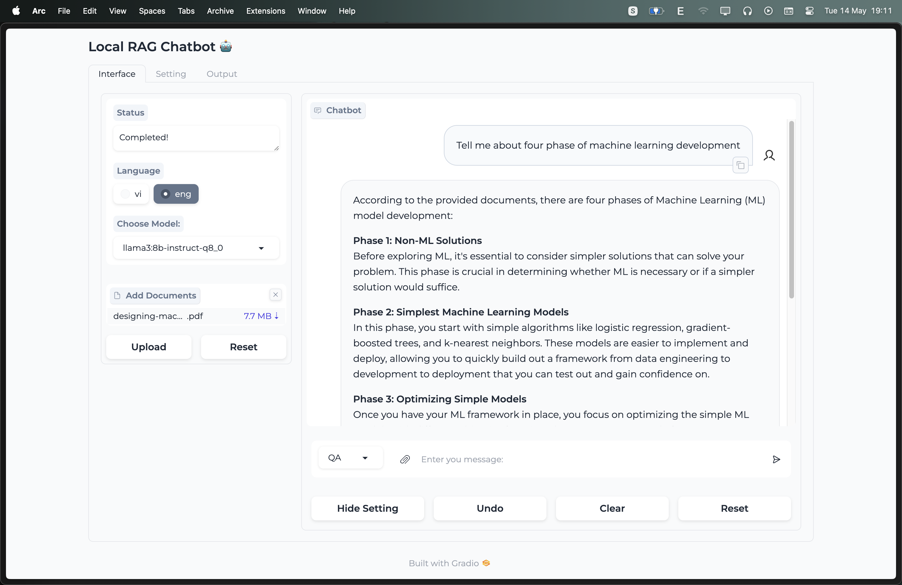

# 🤖 Conversational RAG Chatbot (LangChain Architecture)



A high-performance, modular Conversational Retrieval-Augmented Generation (RAG) Chatbot built with **LangChain**, **Groq**, **PyMuPDF**, **SentenceTransformers**, and **Gradio**.

This project provides end-to-end multi-document question answering and conversational chat capabilities over local PDF documents with advanced hybrid retrieval and neural reranking.

---

## 📖 Table of Contents

- [⭐️ Key Features](#️-key-features)
- [🏗️ Retrieval Architecture](#️-retrieval-architecture)
- [📦 Technology Stack](#-technology-stack)
- [⚙️ Environment Configuration](#️-environment-configuration)
- [💻 Installation & Setup](#-installation--setup)
  - [Option A: Python Virtual Environment (Recommended)](#option-a-python-virtual-environment-recommended)
  - [Option B: Using uv](#option-b-using-uv)
  - [Option C: Docker Compose](#option-c-docker-compose)
- [🚀 Running the Application](#-running-the-application)
- [📊 Evaluation Benchmark](#-evaluation-benchmark)
- [🧪 Running Tests](#-running-tests)
- [📂 Project Structure](#-project-structure)

---

## ⭐️ Key Features

- **Framework Migration**: Fully powered by **LangChain** (`langchain`, `langchain-core`, `langchain-community`, `langchain-groq`, `langchain-openai`) with zero LlamaIndex dependencies.
- **Advanced Multi-Stage Retrieval**:
  - **Dense Semantic Retrieval**: In-memory vector store powered by `BAAI/bge-small-en-v1.5` embeddings.
  - **Sparse Keyword Retrieval**: `rank-bm25` lexical keyword search.
  - **Score Fusion**: Distance-based score normalization (`dist_based_score`) with weights `[0.4, 0.6]`.
  - **Neural Cross-Encoder Reranking**: `BAAI/bge-reranker-base` for fine-grained semantic passage re-scoring.
  - **Query Expansion**: LLM multi-angle query generation (5 queries) for ambiguous questions.
  - **Dynamic Conditional Routing**: Automatically selects dense retrieval for collections $\le 6$ chunks, and LLM-routed hybrid fusion vs two-stage rerank for collections $> 6$ chunks.
- **Conversational Memory**: Multi-turn conversational memory (4000 token limit) with standalone query condensation before retrieval.
- **Flexible LLM Providers**: Primary support for ultra-fast **Groq Cloud API** (`openai/gpt-oss-20b`, `llama-3.3-70b-versatile`, etc.), with fallbacks to **OpenAI** (`gpt-4o`, `gpt-4o-mini`) and local **Ollama** models.
- **Interactive Web Interface**: Built with Gradio Blocks featuring token streaming, PDF upload, language toggling (`English` / `Vietnamese`), system prompt customization, and live terminal logs.

---

## 🏗️ Retrieval Architecture

```
[Uploaded PDFs]
       │
       ▼ (PyMuPDF + Regex Cleaning)
[Sanitized Text]
       │
       ▼ (SentenceSplitter: chunk_size=512, overlap=32)
[Document Chunks] ──► [BAAI/bge-small-en-v1.5] ──► In-Memory Vector Store
       │
       └─────────────────────────────────────────► BM25 Keyword Index

[User Query]
       │
       ├── Node Count <= 6 ──► [Dense Vector Similarity Retriever] (top_k=20)
       │
       └── Node Count > 6  ──► [Router Retriever (LLM Selector)]
                                    │
               ┌────────────────────┴────────────────────┐
               ▼ (Ambiguous Query)                       ▼ (Clear Query)
      [Query Fusion Retriever]                  [Two-Stage Retriever]
      - LLM expands into 5 queries              - BM25 (top 20) + Dense (top 20)
      - BM25 + Dense on each query              - dist_based_score fusion [0.4, 0.6]
      - dist_based_score fusion [0.4, 0.6]      - Cross-Encoder (BAAI/bge-reranker-base)
      - Returns top 6 chunks                    - Returns top 6 reranked chunks
                                    │
                                    ▼
                     [Context Injected Prompt Template]
                                    │
                                    ▼
                     [ChatGroq Streaming Generation]
```

---

## 📦 Technology Stack

- **Orchestration**: `langchain`, `langchain-core`, `langchain-community`, `langchain-text-splitters`
- **LLM Integration**: `langchain-groq`, `langchain-openai`, `groq`
- **Embeddings & Cross-Encoder**: `langchain-huggingface`, `sentence-transformers` (`BAAI/bge-small-en-v1.5`, `BAAI/bge-reranker-base`), `torch`, `transformers`
- **Keyword Search**: `rank-bm25`
- **PDF Extraction**: `PyMuPDF` (`fitz`)
- **Frontend UI**: `streamlit>=1.35.0` (Streamlit App) & `gradio<5` (Gradio Web UI)
- **Configuration & Validation**: `pydantic>=2.8`, `python-dotenv`

---

## ⚙️ Environment Configuration

Copy `.env.example` to `.env` and provide your API keys:

```bash
cp .env.example .env
```

Edit `.env`:

```ini
# Groq API Key (Get a free key at https://console.groq.com/keys)
GROQ_API_KEY=gsk_your_groq_api_key_here

# Optional OpenAI API Key
OPENAI_API_KEY=sk-your_openai_api_key_here
```

---

## 💻 Installation & Setup

### Option A: Python Virtual Environment (Recommended)

```bash
# 1. Create a virtual environment with Python 3.11+
python -m venv .venv

# 2. Activate virtual environment
# Windows:
.\.venv\Scripts\activate
# Linux/macOS:
source .venv/bin/activate

# 3. Install dependencies
pip install -r requirements.txt
```

### Option B: Using uv

```bash
# Install dependencies
uv sync

# Run with uv
uv run python -m rag_chatbot --host localhost
```

### Option C: Docker Compose

```bash
docker compose up --build
```

---

## 🚀 Running the Application

Ensure your `.env` contains your `GROQ_API_KEY`, then start the application:

### Option 1: Streamlit Web Application (Modern UI)

```bash
streamlit run app.py
```
Access the Streamlit interface at: **`http://localhost:8501/`**

### Option 2: Gradio Web Interface

```bash
python -m rag_chatbot --host localhost
```
Access the Gradio interface at: **`http://127.0.0.1:7860/`**

### Command Line Arguments

- `--host`: Host address (`localhost` or `host.docker.internal` for Docker).
- `--model`: Default LLM model identifier (default: `openai/gpt-oss-20b`).
- `--share`: Generates a public Gradio share link.

---

## 📊 Evaluation Benchmark

Run quantitative retrieval and answer-generation evaluations:

```bash
# Evaluate retrieval quality (Hit Rate, MRR, Precision@5, Recall@5, Latency)
python -m rag_chatbot.eval --type retriever --dataset val_dataset/dataset.json --docstore val_dataset/docstore.json

# Evaluate answer generation quality (Faithfulness, Answer Relevancy, Latency)
python -m rag_chatbot.eval --type generator --llm openai/gpt-oss-20b --teacher gpt-4o-mini
```

---

## 🧪 Running Tests

Execute unit and integration tests using pytest:

```bash
pytest rag_chatbot/test/test.py -v
```

---

## 📂 Project Structure

```
├── rag_chatbot/
│   ├── core/
│   │   ├── embedding/        # LangChain HuggingFace / OpenAI embedding factory
│   │   ├── engine/           # Hybrid retriever, cross-encoder reranker & chat engine
│   │   ├── ingestion/        # PyMuPDF parser, text cleaner & SentenceSplitter
│   │   ├── model/            # ChatGroq / ChatOpenAI / ChatOllama model provider
│   │   ├── prompt/           # QA, context injection, query generation & router prompts
│   │   └── vector_store/     # In-memory cosine vector store
│   ├── eval/                 # Synthetic QA generation and retrieval/answer evaluation
│   ├── setting/              # Pydantic configuration schemas
│   ├── test/                 # Test suite
│   ├── ui/                   # Gradio Blocks frontend interface
│   ├── logger.py             # Console log interceptor
│   ├── ollama.py             # Local Ollama service utility
│   ├── pipeline.py           # Core RAG pipeline coordinator
│   └── __main__.py           # Application entrypoint
├── requirements.txt          # Production dependencies
├── pyproject.toml            # Project configuration
├── Dockerfile                # Container definition
├── docker-compose.yml        # Multi-container orchestration
└── README.md                 # Project documentation
```
